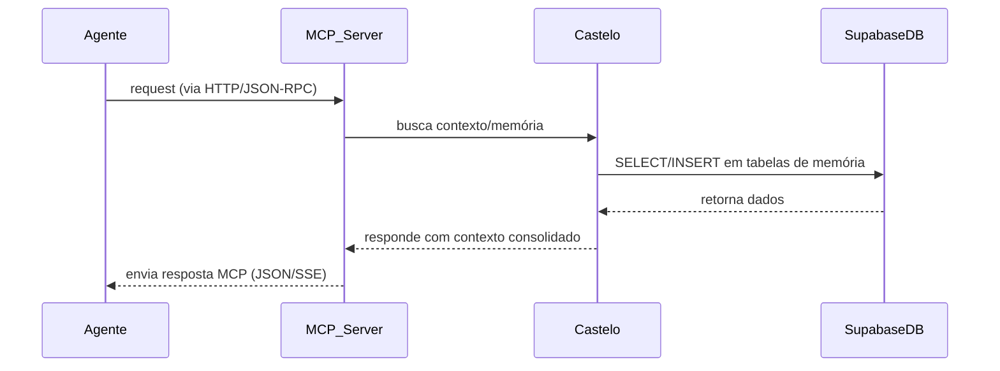

<!-- Proposta original · Sol (Planejamento 2). Texto como o Guardião enviou ao Plasma em 27/09/2026, sem edição. O documento já veio em Markdown. -->

# Resumo Executivo  
Este relatório analisa como usar o Supabase (Banco de dados PostgreSQL gerenciado com Auth, Storage, Realtime, Edge Functions etc.) como base para um servidor MCP e memória “Castelo/Alcear”. Destacam-se as funcionalidades-chave do Supabase, integrações com ferramentas de IA e padrões de arquitetura para multi-tenant, autorização, auditoria, backups e controle de custos. Apresentamos diagramas de fluxo (Mermaid) e tabelas comparativas que avaliam alternativas (complexidade, custo, latência, segurança). Fontes oficiais da documentação Supabase e do protocolo MCP são citadas para embasar cada ponto.

## 1. Plugins e Extensões Oficiais do Supabase  
- **Banco de dados (PostgreSQL)** – Instância dedicada por projeto; suporta [Row-Level Security (RLS)](https://supabase.com/docs/guides/auth/row-level-security) embutida, backups diários (Pro) e PITR (Enterprise). Suporta extensões padrão como `pgvector` (vetores), `pg_sodium` (criptografia), `pg_cron`, `uuid-ossp`, `pgcrypto`, `pgjwt`, `pg_trgm` etc..  
- **Auth (GoTrue)** – Autenticação com e-mail/senha, magic links, OTP, redes sociais e SSO; gera JSON Web Tokens (JWT) usados para RLS. Escalável a dezenas de milhares de usuários/mês (MAU).  
- **Storage (S3-compatível)** – Armazenamento de objetos com CDN global, otimização de imagens e buckets especializados: arquivos, análise (Iceberg) e **vetores**. Controles de acesso refinados via RLS de tabelas de metadados. *Limites:* gratuito 1 GB, Pro 100 GB, além de custos adicionais para armazenamento extra.  
- **Realtime** – Canais WebSocket baseados em `LISTEN/NOTIFY`. Permite sincronizar dados em tempo real com assinantes e lógica de pub/sub. Integrado ao Postgres para repasse de mudanças, adequado para coordenação de agentes em tempo real.  
- **Edge Functions** – Funções serverless (Deno/Node) globalmente distribuídas. Úteis para implementar lógicas customizadas, webhooks ou wrappers MCP expostos via HTTP. O plano Pro já inclui funções e permite domínios customizados; custos extras podem incorrer por tempo de execução e invocações.  
- **Vectors/IA** – Além de `pgvector` no BD, o Supabase oferece **Vector Buckets** no Storage, uma solução S3 com índices HNSW para **similarity search** de milhões de vetores. Vetores podem ter metadados e serem consultados via SQL ou SDK. *(Use pgvector para baixas latências, vetores “quentes” na própria BD; use buckets para arquivar grandes volumes).*  
- **Outros recursos** – Cron jobs via extensão `pg_cron`, enfileiramento (Queues), APIs GraphQL/REST geradas automaticamente, ferramentas de análise (Logflare) para auditoria, etc. Cada recurso tem limites de uso e cobrança conforme plano (ex.: limite de egress). Consulte o [preço oficial](https://supabase.com/pricing) para detalhes (ex.: Pro 250 GB egress, 8 GB DB, 100 GB Storage inclusos).

## 2. Ferramentas/SDKs Terceiros (LLM/MCP)  
- **LangChain** – suporta Supabase como *vector store* usando `pgvector`. Ex.: [`SupabaseVectorStore`](https://js.langchain.com/docs/modules/data_connection/vectorstores/supabase) permite inserir embeddings e fazer *similaritySearch* via SQL (usando funções auxiliares). Permite RAG e pipelines de QA.  
- **LlamaIndex** – fornece `SupabaseVectorStore` (Python) para conectar a um projeto Supabase. Exemplo: notebook Colab que cria coleções e consulta via embeddings armazenados no Supabase.  
- **Hugging Face, Roboflow, Amazon Bedrock** – integrações oficiais (via docs Supabase) permitem usar APIs de modelos (e.g. Hugging Face, Titan) e armazenar resultados em Supabase.  
- **Outros SDKs** – Projetos como `n8n` (automação), `FastAPI`, ou CLIs oficiais (@supabase/js, @supabase/python) podem interagir com Supabase. Por exemplo, o CLI Supabase+MCP (Supabase Agent Plugin) já existe. Além disso, webhooks customizadas podem ser invocadas de Triggers do Postgres via funções ou Edge Functions.  
- **Fluxos RAG/Streaming** – Combinação comum: extrair texto (OCR etc.), gerar embeddings com OpenAI/Vertex AI, armazenar no pgvector ou buckets, e usar LangChain/Notion-like para RAG. Supabase também permite *streaming* de atualizações com Realtime (síncrono) e *listen* a eventos de banco (via RLS).  

## 3. Suporte ao MCP (Protocolo de Contexto)  
- **Padrão MCP** – É um padrão aberto (JSON-RPC sobre canal customizável) para conectar LLMs a sistemas externos. Há implementações de servidor em Node.js, Python, Rust etc. Transportes suportados incluem *Streamable HTTP* (requisições HTTP POST únicas, resposta em JSON ou SSE), além de stdio/nativo.  
- **MCP Supabase (oficial)** – A Supabase mantém um servidor MCP remoto que expõe dados do projeto (BD, docs, funções, etc.). Este produto facilita conectar Claude, ChatGPT e outros via OAuth e expõe ferramentas (list_tables, execute_sql, deploy_function, etc.). Embora útil, ele não gerencia “memória de longo prazo”.  
- **Implementações existentes** – Além do servidor oficial, há bibliotecas como `@microsoft/mcp-client` (vs. Vercel); GitHub de MCP lista clientes (`cursor`, `mcpjam`, etc.). O transporte *Streamable HTTP* é recomendado para conectar o agente ao MCP do Supabase.  
- **Registro e exemplos** – O [registro oficial MCP](https://registry.modelcontextprotocol.io) indexa servidores MCP disponíveis. Embora ainda emergente, há projetos de *memory stores* compatíveis com MCP (ex: m3-memory da skynetcmd) e exemplos no GitHub que usam Supabase como backend RAG.

## 4. Padrões de Arquitetura MCP+Castelo/Alcear no Supabase  
Usamos o Supabase como base para a “memória” (Castelo) acessível via MCP. Boas práticas incluem:

- **Isolamento Multi-tenant** – Separe dados de cada usuário ou equipe usando **RLS** em tabelas de memória (p.ex. `WHERE user_id = auth.uid()`). Pode usar schemas dedicados ou campos de escopo. Valores de JWT (`app_metadata`) ou colunas customizadas identificam contexto e autorizam acesso apenas por agentes permitidos.  
- **Autorização e Segurança** – Use **supabase-auth**/RLS para que cada agente (MCP client) só acesse seu próprio espaço. Configure roles: por exemplo, `service_role` somente no servidor MCP (ambiente seguro), e um *token minimalista* para agentes de terceiros. VPN/HTTPS para transportes MCP HTTP. Registre logs de acesso via funções (`ghost audit`): triggers que gravam tabelas de auditoria ou uso de Logflare integrado.  
- **Esquema de Armazenamento** – Em geral, crie tabelas para “lembranças” e “linhagem”: e.g. `memories (id, tenant, data JSONB, created_at, metadata)`. Para contexto de chat, guarde sessões históricas. Use **vector columns** (pgvector) ou **vector buckets** para embeddings que aceleram buscas sem lotar o schema. Use colunas JSONB para dados semi-estruturados e facilitam consultas.  
- **Fluxo de Requisição** – Exemplo de interação (Mermaid):  

- **Controle de Custos/Egress** – Projete minimizando tráfego excessivo: colete vetores localmente e faça consultas pontuais. Use *caching* e índices (fts, pg_trgm) para reduzir leituras. Lembre que saídas (dados enviados ao agente) contam como egress; agrupe informações. Custos relevantes: egress (5 GB grátis, depois US$0.09/GB), armazenamento adicional ($0.021/GB após 100 GB).  
- **Backups e Continuidade** – Supabase Pro já faz snapshot diário (7 dias). Para memória crítica, considere rotinas de backup adicionais: exportar tabelas via Edge Function periodicamente, replicar dados em outro projeto ou sistema. O Multi-tenancy pode se estender a projetos separados para isolamento (mais caro) ou a diferentes *buckets* (cada cliente no próprio bucket de memória).  
- **Comparativo de Opções**: veja tabela abaixo comparando cenários de implementação de memória/RAG:  

| Abordagem          | Complexidade | Custo      | Latência          | Segurança        |
|--------------------|:------------:|:----------:|:-----------------:|:----------------:|
| **pgvector no DB** | Baixa        | Incorre na cota BD (10GB/Projeto) | Muito baixa (consulta SQL local) | Alta (controle RLS nativo) |
| **Vector Buckets** | Média        | Armazenam vetores fora do BD (custo S3 adicional) | Média (SSE/HTTP vs. DB)   | Alta (integra RLS+metadata) |
| **Banco Externo (Pinecone)** | Alta | Alto (serviço separado) | Variável (rede) | Média (controle via API) |
| **Redis ou NoSQL** | Alta        | Médio (uso contínuo) | Muito baixa (in-memory) | Média (depende da integração) |

## 5. Checklist de Implementação  
- **Infraestrutura Supabase** – Crie projeto(s) e habilite extensões necessárias (`pgvector`, `pg_cron`, etc.). Configure bucket de vetor se usar embeddings. Separe schemas ou projetos para multi-tenant se preciso.  
- **Edge Functions / API** – Implemente um “servidor MCP” (Node/Deno). Por exemplo, um endpoint `/mcp` que entenda JSON-RPC MCP e chame funções internas (ler/escrever memória). Use o [SDK MCP recomendado](https://ts.sdk.modelcontextprotocol.io). Conecte este endpoint no Supabase Edge (vercel-like).  
- **Autenticação e Permissões** – Decida entre chaves de serviço (`service_role`) para total acesso ou OAuth com scopes. Configure RLS nas tabelas de memória: e.g. `USING (auth.uid() = tenant_id)`. Habilite limites de taxa se usar acesso público (gRPC, Funções).  
- **Taxas e Rate-Limits** – No nível da API (supabase functions), monitore e limite requisições por cliente. Use [Auth Rate Limits](https://supabase.com/docs/guides/auth/rate-limits) para proteger endpoints de autenticação. O Supabase também impõe limites gerais (vCPUs, conexões por plano).  
- **Observabilidade** – Use Logflare e banco de logs: configure [query_logs](https://supabase.com/docs/guides/platform/logs) para rastrear queries críticas. Registre entradas em tabelas de auditoria (`ghost.audit`) via triggers Postgres para cada gravação de memória. Monitore métricas do Supabase (nº de requisições, latência) no painel.  
- **Testes** – Use o Supabase CLI/Docker para testes locais (migrar banco, rodar Edge Functions). Simule fluxos MCP com clientes (ex.: `curl` POST em `/mcp`). Verifique RLS bloqueando acessos indevidos. Faça testes de carga no vetor: indexe X vetores, realize consultas semelhantes e avalie latência.

## 6. Riscos, Lacunas e Próximos Passos  
- **Lacunas Atuais** – O Supabase não tem *webhooks nativos de banco*, exigindo uso de triggers/Edge Functions para eventos. A indexação vetorial em grande escala (milhões de vetores) está limitada ao novo Vector Buckets (beta). Ainda não há suporte nativo a TLS mútuo ou VPC isolada.  
- **Segurança** – Conectar agentes pode expor dados sensíveis. É crítico usar RLS e nunca expor chaves de serviço. O servidor MCP deve validar comandos para não permitir SQL injetado.  
- **Egress/Custo** – Cargas elevadas de RAG podem estourar limites de egress. Planejar orçamentos e alertas. O uso intensivo de Edge Functions ou Storage pode gerar custos variáveis não triviais.  
- **Recomendações POC** – Criar uma prova de conceito mínima: por exemplo, um agente simples que se conecta ao endpoint MCP no Supabase local, executa uma query de memória em Postgres e retorna resposta. Em paralelo, testar o uso de Vector Buckets para vetores. Verificar latências de consulta e escalabilidade.  
- **Próximos Experimentos** – Avaliar ferramentas de *caching* ou bancos vetoriais externos para comparação de desempenho. Testar o Alcear (memória pública) com monitoramento de custo-uso. Explorar “ghost” e “radar” para logs e monitoramento contínuo.  

**Fontes:** documentação oficial Supabase (Armazenamento, Auth, AI Vectors) e especificação MCP foram usadas para embasar funcionalidades e padrões aqui descritos.
